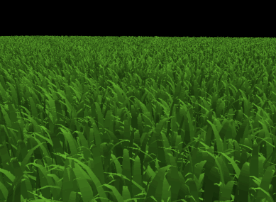
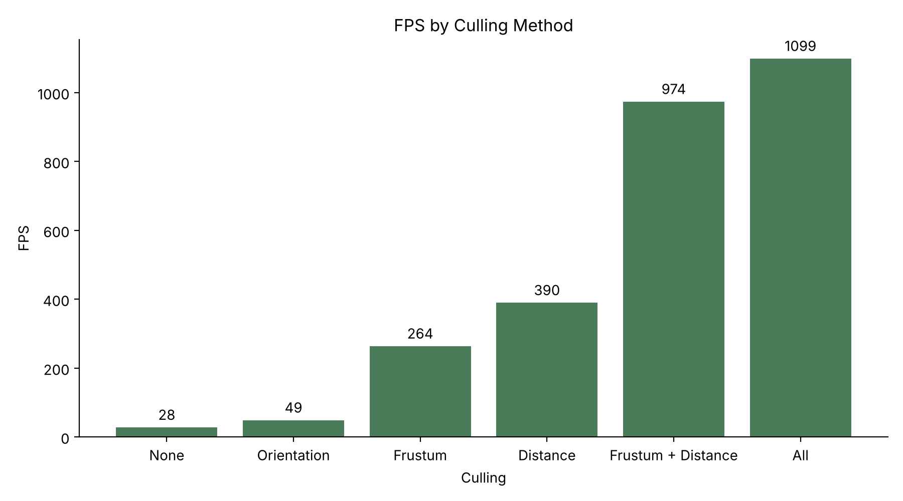
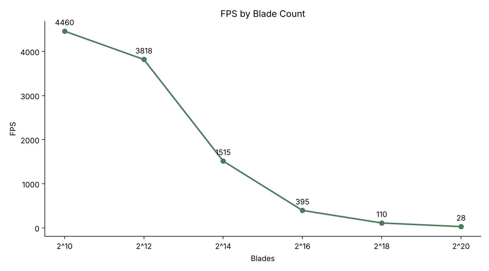
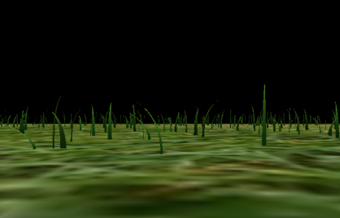

Vulkan Grass Rendering
==================================

**University of Pennsylvania, CIS 565: GPU Programming and Architecture, Project 5**

* Ryan Morris
  * [LinkedIn](www.linkedin.com/in/r19)
* Tested on: Windows 11, Intel i7-12700H @ 2.3GHz 64GB, GeForce RTX 3070 Ti Laptop GPU 8GB

*2^20 blades of grass in 120x120 square with no culling*

## Overview

This project is a Vulkan implementation of [Responsive Real-Time Grass Rendering for General 3D Scenes](https://www.cg.tuwien.ac.at/research/publications/2017/JAHRMANN-2017-RRTG/JAHRMANN-2017-RRTG-draft.pdf) (Jahrmann and Wimmer, 2017). Each blade of grass is a quadratic Bezier curve defined by three control points: a base position `v0` representing the root of the grass, a guide `v1` representing vertical height, and a physical tip `v2`, horizontally offset from `v1` which forces act on. A compute shader simulates and culls every blade each frame, and the surviving blades are drawn by a graphics pipeline that uses tessellation to turn each curve into blade geometry.

## Features Implemented

### Grass Rendering

Each blade is submitted as a single-vertex patch. The vertex shader moves the blade into world space, and the tessellation control shader subdivides each patch into a strip one quad wide and eight quads tall. The tessellation evaluation shader evaluates the Bezier curve at each height using de Casteljau's algorithm. The fragment shader shades each blade with a gradient from dark green at the base to light green at the tip, using simple two-sided diffuse lighting.

### Physical Simulation and Forces

The compute shader applies three forces to the tip `v2` every frame. Gravity combines a downward environmental pull with a smaller "front gravity" toward the blade's facing direction. Recovery acts as a spring that pulls `v2` back toward its upright position, scaled by each blade's stiffness. Wind uses a custom function of time and blade position, and its strength is scaled by the paper's alignment term so that blades already facing into the wind or bent over are pushed less. After the forces are applied, the corrections from section 5.2 of the paper keep `v2` above the ground, reposition `v1` so the blade curves naturally from its base, and rescale both control points so the blade keeps its original length. The updated blade is written back to the blade buffer so the motion carries over between frames.

### Culling

After the simulation, each blade is tested for visibility and only the survivors are written to the buffer that is drawn, using an atomic counter that also serves as the vertex count for an indirect draw call. The counter is reset with `vkCmdFillBuffer` before each dispatch. Orientation culling removes blades that are viewed nearly edge-on, where the absolute dot product of the horizontal view direction and the blade's width direction exceeds 0.9, since those blades would render as sub-pixel slivers. View-frustum culling projects the base, approximate midpoint and tip of each blade into clip space and removes the blade only if all three fall outside the frustum, with a tolerance of 1.0 in clip space to account for blade width. Distance culling removes every blade farther than 40 units from the camera, and thins the remaining blades across 10 distance buckets so that progressively more blades are dropped with distance. Each test can be toggled with a `#define` at the top of `compute.comp`.

## Performance Analysis

### Culling Methods

These measurements use 2^20 blades on a 120 x 120 plane, which is substantially larger than the default 15 x 15 plane but keeps a comparable grass density. The camera was held at the same position for every run.

| Culling | FPS (higher is better) | Frame time (ms) | Notes |
|---|---|---|---|
| None | 28 | 35.7 | |
| Orientation | 49 | 20.4 | Causes some flickering, 0.9 dot product threshold |
| Frustum | 264 | 3.8 | Tolerance +/-1.0 |
| Distance | 390 | 2.6 | Max distance 40.0, 10 buckets |
| Frustum + Distance | 974 | 1.0 | |
| All | 1099 | 0.9 | |

Without culling, all million blades are tessellated and rasterized every frame, which limits the renderer to 28 FPS. Orientation culling gives the smallest improvement, cutting frame time by about 43%, because it only removes blades within a narrow range of angles from edge-on, and the set of removed blades changes as the camera moves, which causes visible flickering. Frustum culling is far more effective at roughly 9x faster, since the 45 degree field of view only covers a wedge of the large plane and everything outside it is discarded. Distance culling is the most effective single test at about 14x faster, because on a 120 x 120 plane the majority of blades lie beyond the 40 unit cutoff, and the buckets thin out much of what remains.

Frustum and distance culling work well together because they remove largely different blades: frustum culling removes nearby blades that are off screen, while distance culling removes far blades that are on screen. Combined they reach 974 FPS. Adding orientation culling brings the total to 1099 FPS, a smaller gain than orientation culling gave on its own, because many of the blades it would remove have already been culled by the other two tests. Overall, culling improves frame time by roughly 39x for this scene, and the benefit grows with the size of the scene relative to the camera's view.

### Number of Blades

Here is how the rendering performance changes with the number of blades. All culling is toggled off for the purposes of this comparison - this ensures that each blade is rendered, which is the purpose of comparing the number of blades and the effect on performance.

| Blades | FPS (no culling) |
|---|---|
| 2^10 | 4460 | 
| 2^12 | 3818 |
| 2^14 | 1515 |
| 2^16 | 395 |
| 2^18 | 110 |
| 2^20 | 28 | 

*The 120x120 grid with only 2^10 blades of grass (4460fps, where plateau is close to being reached)*

At low blade counts, performance is limited by fixed per-frame overhead rather than by the grass itself. Going from 210 to 212 blades quadruples the work but only raises frame time from about 0.22 ms to 0.26 ms, because command submission, presentation and synchronization dominate the frame and the GPU is mostly idle.

From 214 blades onward, the grass becomes the bottleneck and frame time scales almost linearly with blade count. Each 4x increase in blades raises frame time by roughly 3.6 to 3.9x, from 0.66 ms at 214 to 2.5 ms at 216, 9.1 ms at 218 and 35.7 ms at 220. This is expected, since every blade is simulated, tessellated into the same number of triangles and rasterized independently, so the cost per blade stays constant. Calling matters at high blade counts because removing a fraction of the blades removes the same fraction of the frame time.

### Build note

The top-level `CMakeLists.txt` and `external/GLFW/CMakeLists.txt` were modified so the project configures with current versions of CMake (version raised to 3.5) 
